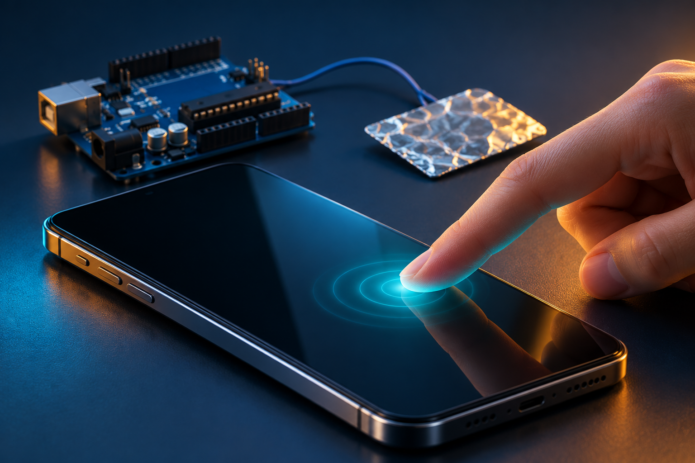
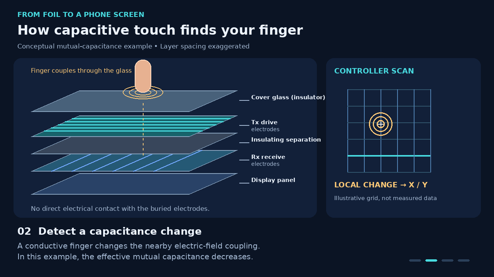
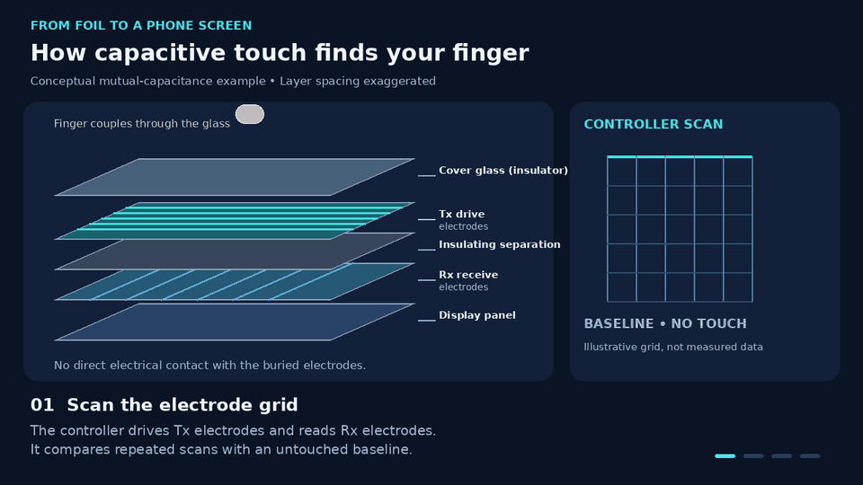
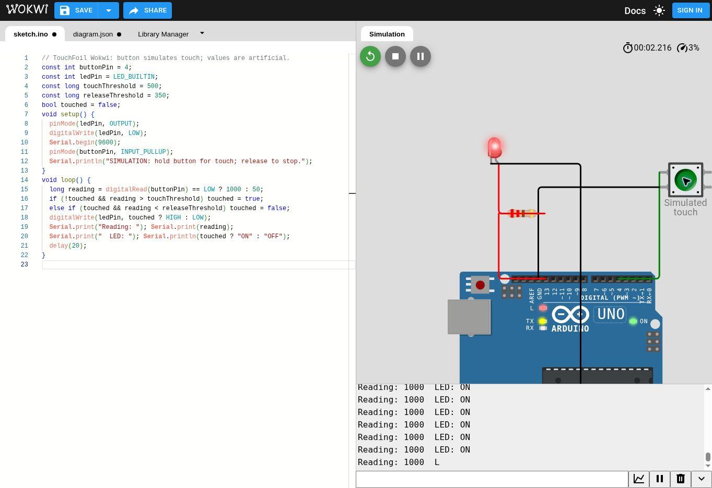
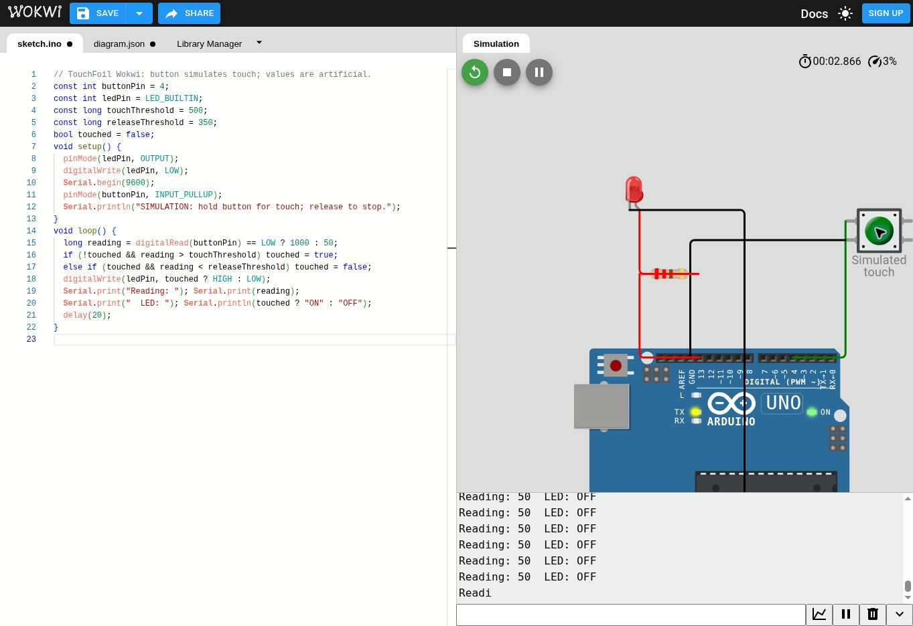

# CapaciSense — Capacitive Touch Sensing System

Touch a foil pad to turn on an LED; release it to turn the LED off. A 10 MΩ resistor and the CapacitiveSensor library measure the change in capacitance near the pad. The reading is a relative timing value, not a capacitance measurement in farads.

*AI-generated conceptual illustration; not a wiring reference. Use the wiring table and `wiring.svg` for the real build.*

## Smartphone touchscreen: how the same idea is used

Your foil project detects one touch area. A smartphone uses a patterned sensor grid and a dedicated touch controller to locate fingers across a screen. Both depend on a conductive finger changing capacitance, but the phone does not use the Uno's resistor-timing circuit.

### 1. The screen contains transparent sensing electrodes

A typical projected-capacitive touchscreen has an insulating cover glass and transparent patterned electrodes, often made from indium tin oxide (ITO). These are conductive patterns, rather than ordinary exposed wires. Other electrode materials also exist. The display creates the picture; the touch-sensing structure detects your input. Sensors may be integrated into the display, so the separated layers shown here are a teaching model, not a teardown of every phone.

### 2. Your finger couples electrically through the glass

Body fluids contain ions, making your body conductive. Bringing a finger close to the electrodes changes the local electric field and capacitance. The glass remains an insulator: your finger does not need to make direct electrical contact with the electrodes underneath it. Moisture on the outside of the skin is not required.

### 3. A controller detects a change from the baseline

In the illustrated **mutual-capacitance** example, the controller drives transmit (Tx) electrodes and measures coupling to receive (Rx) electrodes. A finger disturbs that coupling; in the usual shunt-dominated case, the effective mutual-capacitance signal decreases. The controller compares the readings with an untouched baseline and filters noise.

This is more accurate than saying the finger simply “absorbs charge” or makes a conducting bridge through the glass. Touch systems can also measure **self-capacitance**, where a finger typically increases the apparent capacitance of an electrode relative to the circuit's reference. The direction of a raw digital reading also depends on the controller's measurement method.

### 4. The phone finds a tap or swipe

The touch controller estimates X and Y coordinates from the pattern of changed readings, often combining several neighboring sensing nodes. It sends touch positions to the phone's software. Repeated positions allow software to interpret gestures such as swipes; suitable grids and controllers can track multiple fingers for pinch-to-zoom.

### Watch the mechanism

**[Watch or download the touchscreen explainer — MP4, 12 seconds](media/smartphone-touch-explained.mp4)**

The GIF and video are silent, captioned teaching animations. Grid size, spacing, timing and highlighted signal changes are illustrative, not measured phone data. The dashed marker connects the finger location to the sensing layers; it does not represent current flowing directly through the glass.

### How this compares with CapaciSense

| Feature | Arduino foil project | Smartphone touchscreen |
| --- | --- | --- |
| Sensor | One conductive foil pad | Transparent patterned electrode grid |
| Measurement | Relative charge/discharge timing through a large resistor | Dedicated controller measures capacitive signals |
| Output | Touched / released | X/Y positions and touch events |
| Response | LED on/off | Taps, swipes and supported multi-touch gestures |
| Calibration | Adjust thresholds for the real setup | Baseline tracking and noise filtering |

The project's **Wokwi version** substitutes a button and artificial readings; it demonstrates the LED logic only. It does not simulate the physics shown in the smartphone animation.

### Everyday uses and practical limits

- **Phones and tablets:** light finger contact controls the interface without pressing two conductive layers together.
- **Touchpads, appliance panels and some elevator buttons:** capacitive sensing can operate behind an insulating surface. Many elevator buttons are still mechanical; appearance alone does not identify the sensor type.
- **Ordinary plastic styluses:** generally do not provide enough capacitive coupling. Conductive capacitive styluses and supported active pens work differently.
- **Gloves:** ordinary thick insulating gloves often reduce the signal too much. Conductive touchscreen gloves or controllers with a glove mode can work; this is not an absolute limitation of every capacitive screen.
- **Resistive screens:** pressure brings conductive layers into contact, so they can respond to an ordinary nonconductive stylus. This differs from the capacitive sensing described here.

## Test without an Arduino — Wokwi

1. Open https://wokwi.com/projects/new/arduino-uno
2. Copy all of `Wokwi/sketch.ino` into the website's `sketch.ino` tab, replacing its existing code.
3. Copy all of `Wokwi/diagram.json` into the `diagram.json` tab, replacing its existing content.
4. Click the green Start Simulation button. No additional library is needed for this version.
5. Hold the green **Simulated touch** button: the red LED and onboard L LED turn on.
6. Release the button: both LEDs turn off.

If you want to keep the button pressed, Ctrl-click it (Cmd-click on Mac), then click again to release. The simulator may run slower than real time; allow its serial output to catch up.

The button supplies artificial readings: 1000 while pressed and 50 while released. This tests the LED control behavior, not physical capacitance, water sensing, electrical noise, or real foil sensitivity. For actual hardware use `CapaciSense/CapaciSense.ino` and the original resistor wiring, not the Wokwi button wiring.

### Actual Wokwi test

The included Wokwi sketch compiled and ran in the browser. Observed idle = `Reading: 50  LED: OFF`, pressed = `Reading: 1000  LED: ON`, released = `Reading: 50  LED: OFF`. Screenshots below show the real simulator session captured before the project was renamed to CapaciSense; the tested circuit and behavior are unchanged.

**[Watch the Wokwi test slideshow — MP4, 9 seconds](media/wokwi-test-slideshow.mp4)**

This video assembles the actual ON/OFF screenshots into a captioned slideshow. It is not a live screen recording. No physical Arduino test is claimed.

## Parts

- Arduino Uno R3 (ATmega328P), USB cable, breadboard and jumper wires
- One 10 MΩ resistor (10,000,000 ohms, not 10 kΩ)
- Small aluminum foil pad and clear tape
- Optional external LED and 220 Ω series resistor; otherwise use the onboard L LED

## Wiring — disconnect power first

| Connection | Destination |
| --- | --- |
| D2 | First end of 10 MΩ resistor |
| Other end of 10 MΩ resistor | D4 |
| D4 junction | Foil pad |
| D13, if using external LED | 220 Ω resistor, then LED anode (long leg) |
| LED cathode (short leg / flat edge) | GND |

Put the two ends of the 10 MΩ resistor in different breadboard rows. Do not connect the sensor pad to 5V or GND. Keep the sensor wire short to reduce noise. Cover the foil with thin clear tape to reduce direct static discharge; sensitivity may need adjustment. See wiring.svg for a connection diagram.

## Upload and run

1. Extract this ZIP.
2. Open `CapaciSense/CapaciSense.ino` in Arduino IDE.
3. In Library Manager, search for and install **CapacitiveSensor** by Paul Badger / Paul Stoffregen.
4. Select **Arduino Uno** and the connected serial port.
5. Click Verify, then Upload.
6. Open Serial Monitor at **9600 baud**. Leave the pad untouched initially.
7. Touch and release the pad while observing readings and the onboard LED.

## Adjust sensitivity

The starting thresholds (500 on, 350 off) are examples, not universal values. First record several untouched readings, then several touched readings. Choose both thresholds between these groups, with the release threshold below the touch threshold. Example: idle 20–80 and touched 800–1500 can use on=500 and off=350. If readings overlap, improve wiring or reduce noise before choosing thresholds.

The two thresholds reduce flickering. Automatic periodic baseline recalibration is disabled so a sustained touch is not automatically absorbed into the baseline. Reset with your hands away if the environment or pad changes.

## Troubleshooting

- **CapacitiveSensor.h missing:** install the library through Library Manager.
- **Always on:** increase thresholds, shorten wire, or try a smaller pad. A 10 MΩ resistor may detect a nearby hand before contact.
- **Never on:** check the foil connection, D2/D4 wiring, resistor value and observed readings. Lower thresholds only after measuring.
- **Sensor error:** the library returned a negative result; check for shorts to power/ground, a missing resistor, or timeout caused by excessive capacitance.
- **External LED dark but onboard L works:** check LED polarity and the series resistor.
- **Battery vs USB differs:** readings depend on the environment and power setup; calibrate in the configuration you will use.

## Fruit or water variation

After getting foil working, replace the foil connection with a probe touching fruit or water in a separate small nonconductive bowl, then recalibrate. Keep the Arduino, breadboard and USB connections dry and away from the bowl. Only the low-voltage sensor probe goes into water. Do not connect this experiment to mains wiring or powered appliances. Foil under tape is the simplest first build.

## What the code does

- `CapacitiveSensor(2, 4)` selects D2 as send and D4 as receive.
- `capacitiveSensor(30)` takes 30 samples.
- Negative readings switch the LED off and print an error.
- Crossing the upper threshold turns the LED on; crossing the lower one turns it off.
- Serial output helps you tune the thresholds.

## Validation status

Prepared and reviewed against the library documentation. The real capacitive-sensing sketch has not been compiled or tested on physical hardware here. The separate Wokwi button sketch was compiled and tested in Wokwi as described above. Verify in Arduino IDE and calibrate on your board. The Wokwi result validates the button-based LED demo, not real capacitive sensor performance.

## References

- https://www.pjrc.com/teensy/td_libs_CapacitiveSensor.html
- https://github.com/PaulStoffregen/CapacitiveSensor

- [Microchip: 2D touch surfaces and touchscreen controllers](https://www.microchip.com/en-us/products/sensors-touch/mcus-on-chip-touch/2d-touchpads)
- [Microchip: introduction to the Peripheral Touch Controller](https://developerhelp.microchip.com/xwiki/bin/view/applications/touch/ptc/)
- [Microchip: self-capacitance measurement](https://onlinedocs.microchip.com/oxy/GUID-A8A0085D-58D1-4E41-A07D-B93BFDE11AFE-en-US-4/GUID-057D7429-BF1E-4084-A4BA-296ABD29CE00.html)
- [Microchip: ITO X/Y sensing matrices](https://developerhelp.microchip.com/xwiki/bin/view/products/mcu-mpu/32bit-mcu/sam/l10-l11/peripherals/ptc/)
- [Infineon: capacitive touch sensor stack-up](https://community.infineon.com/t5/PSOC-4/How-to-Capacitive-Touch-Sensor-StackUp-Guide/td-p/218743)

## Media and GitHub usage

Keep `README.md`, `media/`, and `Wokwi/` together when uploading the extracted project to GitHub. Images and the GIF use relative links so they appear in the README. The MP4s are clickable file links; inline video playback depends on the viewer, so the GIF provides the embedded animated preview.

The hero image was created with the built-in image-generation tool. Prompt: “Conceptual editorial 3D illustration of an unbranded phone being gently touched, with a foil pad and generic Arduino-like board in the background; navy, cyan and amber lighting; no technical labels or wiring claims.” The labeled diagram and animation were drawn programmatically for consistent geometry and text. Wokwi screenshots are captured simulation evidence.

The dependency is installed separately and retains its own license.
